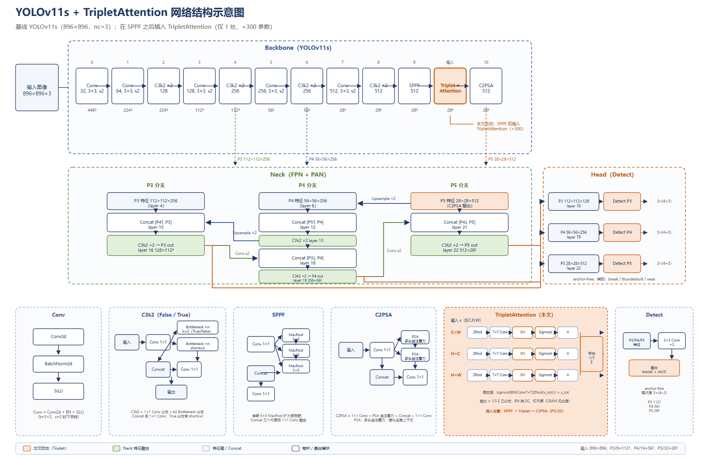

# 架空输电线缺陷检测

基于 YOLOv11s 的输电线路三类缺陷检测（断股 / 雷击 / 磨损），输入 896×896。
项目包含分辨率对比、CBAM 与 TripletAttention 消融、WIoU v3 与磨损过采样单因素实验，
以及完整的误检/漏检归因。

除训练与评估外，本项目还包含**两条边缘部署线**：K230（自购板，实时 5 fps）与
K210（借测板，极限压缩到 0.75 fps），用于验证模型在真实硬件上的边界。

> **口径提示（2026-10-27 重定）**：按 1080 个视觉段整体重划分并从头重训后，
> 跨段泛化不是一个点而是 **74.7% ~ 89.2%** 的区间（三种子 test 74.67%，同颗权重 val 89.15%）。
> 早期报的 92.12% 含 **44.1% 相邻帧泄漏**（179 图 test 里 79 张与 train 同段），
> 属开卷成绩，现仅作历史对照。详见 `WORKLOG.md` A.9.62 / A.9.63 / A.9.65。

## 边缘部署

训练完成后把模型落到两块开发板上，目录与文档各自独立：

| 平台 | 板子 | 输入 | 速度 | 模型体积 | 入口 |
|---|---|---|---:|---:|---|
| **K230**（主线） | 立创庐山派，CanMV v1.8 / nncase 2.11 | 640 | **5.0 fps** | 3.44 MB | [deploy/](deploy/README.md)、[manual/](manual/README.md) |
| **K210**（极限测试） | MaixPy v0.6.2 / nncase 0.2 | 224×320 | 0.75 fps（1328 ms/帧） | 489 KB | [k210/](k210/K210部署总结.md) |

- **K230** 是项目立项时就确定的部署目标：`export_nano_onnx.py` → `make_uint8_onnx.py`
  （归一化写进图内）→ `compile_kmodel.py`（`--u8raw --calib-method NoClip`）→
  base64 分块上传 + 板上 SHA256 校验 → `cam_demo3.py` 摄像头实时检测。
  `manual/` 另有一份「四步手动转换」教程，逐步说明每步看什么数字才算过。
- **K210** 是借来摸底的一次性测试：8 MB 内存、512 KB 堆，标准 YOLOv5n（1.94 MB）三种加载方式
  全部 OOM。最终把 width 砍到 0.125（44.4 万参数），并把 nncase 0.2 不支持的算子全部改写
  （SiLU→ReLU、SPPF→SPPFK、动态 Upsample→固定 scale），压到 489 KB 才跑起来。
  雷击单类模型跨段 mAP50 **61.0%**、板上误报 0 次、`{fail}` 经 UART1 触发蜂鸣器。
- **边界**：0.75 fps 只够「巡检拍照、单帧定案」，做不了实时视频，也做不了瞬时雷击闪络捕捉。
  这是芯片代差（8 MB vs 128 MB），不是模型问题。完整记录见
  [k210/K210部署总结.md](k210/K210部署总结.md)。

## 关键结果

下表为 **NMS IoU 0.7** 的早期口径，仅用于模型间横向对照（项目早期统一在此口径下筛选）；
对外主结果采用 0.5 口径，见本节末。**两套数字不可跨行比较**——同一权重在 0.5 口径下
比 0.7 高约 1.3–1.5 pt。

test 集，3 个种子（42/43/44）均值，NMS IoU 0.7：

| 模型 | 640 | 896 |
|---|---:|---:|
| YOLOv11s 基线 | 88.42 | 90.79 |
| + CBAM（BN 重标定，neck/sppf） | 90.05 | 90.12 |
| + TripletAttention（neck/sppf） | 89.00 | **91.19** |
| YOLO26s 基线 | — | 91.35 |

> YOLO26s 的数字由 ultralytics **8.4.178** 产出（其权重格式 8.3.180 不支持），
> v11 系由 8.3.180 产出。跨代差值中混有一个无法分离的库版本项，
> 因此“两代模型相差 x pt”可以报，但**不能归因于结构差异**。

**当前对外口径（v3，段级留出集，2026-10-27）**：mAP50 报区间 **74.7% ~ 89.2%**，
mAP50-95 报 **37.71%**（三种子 test 203 图）。区间的来源是"留出哪批视觉段"：
同一批训练产出的同一颗 s42 权重，test 75.91% vs val 89.15%，差 13.2 pt；
而三种子之间的跨度只有 2.74 pt。**段划分的方差是种子方差的 5 倍**，
所以这类数据上的单点指标没有意义。

历史口径两行，均只作对照、不得对外引用：
`179 图开卷`（含 44.1% 同段泄漏）mAP50 92.12% / mAP50-95 54.23%；
`帧级隔离 100 图` mAP50 89.98%（相邻段仍在 train，见 `WORKLOG.md` A.9.57）。

推理端后处理：三种子 WBF 在同卷内把 74.67% 提到 **77.76%（+3.09 pt）**，
是唯一越过 1.60 pt 噪声地板的增益；TTA 三颗种子全负（−1.44/−1.30/−0.71），弃用。

## 关键发现

- **分辨率是主变量**：896 相比 640，基线 mAP50 提升 2.36 个点。
- **注意力没有稳定增益**：CBAM 在 896 反而低于基线；Triplet 在 896 高 0.40 个点，
  但种子区间重叠，640 与 896 方向也不一致，不能宣称有效。
- **mAP50 与 mAP50-95 分化**：开卷口径下 mAP50 到 92%、mAP50-95 只有 54%，说明“找到”不难、
  “框准”仍有明显差距；误差主要来自 break 的低置信度漏检与重复框。
- **数据存在相邻帧泄漏**：179 图 test 中 **44.1%（79 张）** 与 train 同处一个视觉段
  （dHash ≤2 且 64×64 MAE ≤20 双闸聚类，共 1080 段）。已做三轮处理：
  帧级隔离（100 图）→ 段级整体重划分并重训（1401/181/203，跨段 0）→
  六目标配平划分（三类框 split 占比全部 9.7~11.4%，越界项 0，待重训）。
- **负结果同样记录**：WIoU v3（+0.19）、磨损 2× 过采样（+0.75）均只有单种子，
  按预注册规则未追加种子、不写入主结果；P2 小目标头因部署设备算力不足而未执行。

## 网络结构



TripletAttention（WACV 2021）插在 backbone 的 SPPF（第 9 层）之后、C2PSA（第 10 层）之前，
分 C×H、C×W、H×W 三支做注意力，三支输出取平均。每支为
`ZPool → 7×7 Conv(bias=False) → BN → Sigmoid`，全模块仅 300 参数
（baseline 9,428,953 → 9,429,253，nc=3）。

结构图的 SVG / PDF / draw.io 源文件见 [report/figures/](report/figures/)，
可继续在 draw.io 或 Illustrator 中编辑。

## 数据集

- 3 类：`break`（断股）、`thunderbolt`（雷击）、`wear`（磨损）
- 1,785 张。v1 随机划分：train 1,428 / val 178 / test 179（8:1:1，seed 42）；
  v3 段级划分：train 1,401 / val 181 / test 203（1080 段零跨 split，`dataset_noleak/`）；
  配平版划分（1409/173/203）见 `dataset_noleak_strat/assign_strat.json`，尚未重训
- 来源：教师项目提供的 1,800 张现场图像，模型预标注 + MobileSAM 辅助，人工复核；
  15 张无目标图像剔除
- 因版权与体积，数据集、权重、训练产物未上传

### 仓库里没有的东西，以及怎么补

| 缺什么 | 为什么不在 | 怎么得到 |
|---|---|---|
| 数据集（`dataset_*`、`k210/*/dataset`） | 现场图像版权归提供方，且体积远超 Git 限制 | 联系数据提供方；`.gitignore` 已列出全部排除路径，放回原路径即可复现 |
| 权重（`*.pt` / `*.onnx` / `*.kmodel`） | 体积；`.kmodel` 还与编译器版本绑定 | 训练脚本可从 `yolo11s.pt` / `yolo5n.pt` 官方权重重新产出；kmodel 用 `compile_kmodel.py`、`ncc` 重编（命令见各目录 README） |
| 训练与评估产物（`runs/`、`logs/`） | 体积大且与本机环境绑定 | 按 [WORKLOG.md](WORKLOG.md) 中各 run 的命令重跑 |
| 实验报告 docx / PDF | 课程交付物，不适合公开 | —— |
| 安全帽试验数据（`dataset_helmet/_raw/`、`k210/hat/dataset/`） | 第三方数据集（SHWD）再分发受限 | 见 [dataset_helmet/README.md](dataset_helmet/README.md) 中的来源与重建脚本 |

**复现顺序**：数据放回原路径 → 按 `code/` 训练 → `code/tools/eval/` 评估 →
需要上板时看 `deploy/`（K230）或 `k210/`（K210）的 README。

## 复现

环境：Python 3.12，ultralytics 8.3.180，PyTorch 2.11（CUDA 12.8），RTX 4060。
训练统一为 60 epochs、batch 8、SGD（lr0=0.01、lrf=0.005、cos_lr）、AMP、`workers=0`（Windows）。

```bash
# 896 基线（单种子）
python code/yolov11/train_att_640.py --att baseline --imgsz 896 --seed 42

# TripletAttention 臂
python code/yolov11/train_att_640.py --att triplet --mode neck_sppf --imgsz 896 --seed 42

# CBAM + BN 重标定臂
python code/yolov11/train_att_640.py --att cbam_bn --mode neck_sppf --imgsz 896 --seed 42
```

数据路径在各训练脚本顶部的 `BASE` / `DATA` 常量中，按本机布局修改。
评估脚本在 [code/tools/eval/](code/tools/eval/)，各 run 的完整命令记录在
[WORKLOG.md](WORKLOG.md) 与 [DIRECTORY.md](DIRECTORY.md) 中。

## 目录结构

完整索引见 **[DIRECTORY.md](DIRECTORY.md)**（含各目录状态与“勿动”标记）。简表：

- [code/](code/)：训练、评估、数据处理脚本
  - [code/yolov11/](code/yolov11/)：主实验；`triplet_att.py`、`cbam_bn.py`、`wiou_v3.py` 为模块实现
  - [code/yolov12/](code/yolov12/)：YOLOv12 对照
  - [code/upscale/](code/upscale/)：Triplet/CBAM 探针、CPM 磨损数据生成
  - [code/tools/](code/tools/)：参数/注入/切分核查、评估、数据处理
- [exp_upscale/](exp_upscale/)：第二批起的新实验区（本仓库只保留配置与脚本）
- [deploy/](deploy/README.md)：K230 部署（导出/编译/上传/板上运行，含一键命令）
- [manual/](manual/README.md)：K230 四步手动转换教程（给第一次上板的人看）
- [k210/](k210/K210部署总结.md)：K210 极限部署（结构改造、阈值标定、报警链路）与安全帽试验脚本
- [report/](report/)：结构图、数据汇总与生成脚本（报告本体不公开）
- [scripts/](scripts/)：串行实验链入口
- WORKLOG.md：项目全量工作记录（含失败实验与决策过程）
- DIRECTORY.md：目录与产物地图
- PROTOCOL.md：三方协作协议

## 说明

- 所有对比固定数据切分、训练轮数与评估口径；val 用于选择，test 只做最终评估。
- `runs/` 为封版阶段产物，`exp_upscale/runs/` 为后续实验产物；训练产物均未入库。
- 各框架采用各自推荐配置，通用超参（优化器、初始学习率、epochs、batch、imgsz）保持一致。
